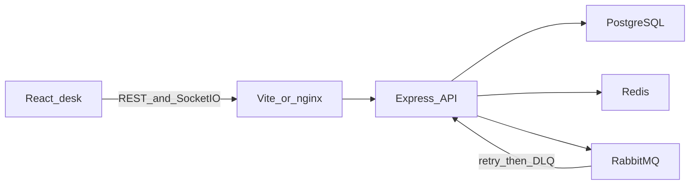
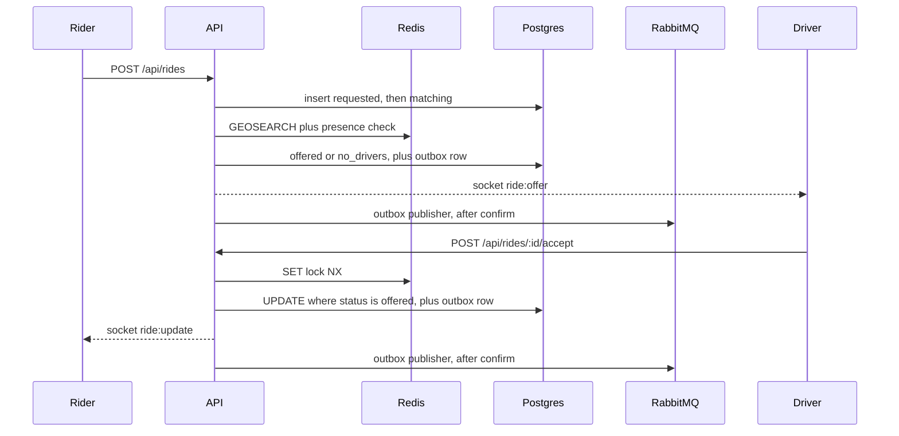
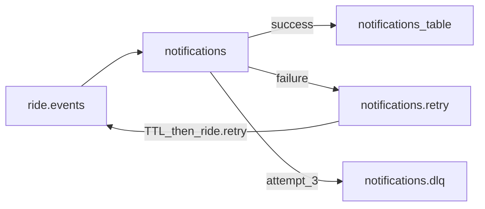

# RideFlow architecture

One monorepo. The React app is a thin desk. The API owns rides, presence, and events. Postgres is the source of truth. Redis is for presence, locks, cache, and Socket.IO fan-out. RabbitMQ is for notifications after a ride change is already saved.

## Layout

```text
apps/api            Express, Socket.IO, Redis, RabbitMQ, Jest
apps/web            Vite + React rider and driver desks
packages/shared     ride states, fare math, shared DTOs
docker-compose.yml  Postgres, Redis, RabbitMQ, API, web, Prometheus, Grafana
```

Shared types are imported by both apps so the ride status list cannot drift. The web app never talks to Postgres, Redis, or RabbitMQ.

## Runtime



In development, Vite proxies `/api` and `/socket.io` to the API. In Docker, nginx does the same, so the browser stays on one origin.

Startup in `apps/api/src/index.ts`:

1. Connect to Redis, then apply `schema.sql` on Postgres. Both retry if the dependency is still starting.
2. Open RabbitMQ and declare the exchange and queues.
3. Start the notification consumer and the outbox publisher.
4. Attach Socket.IO with the Redis adapter.
5. Expire stale offers every 15 seconds.

## API modules

| Path | Job |
| --- | --- |
| `modules/auth` | Register, login, JWT, `/me` |
| `modules/drivers` | Online, offline, heartbeat, nearby search, profile |
| `modules/rides` | Create, match, accept, reject, trip steps, cancel |
| `redis/geo.ts` | `GEOADD`, presence TTL, `GEOSEARCH` |
| `redis/cache.ts` | Fare quote and driver profile cache |
| `redis/idempotency.ts` | Replay of create and accept |
| `realtime/gateway.ts` | Socket.IO rooms and the Redis adapter |
| `mq/rabbit.ts` | Exchange, retry queue, dead-letter queue, consumer |
| `middleware` | Request id, auth, role, rate limit, errors |
| `packages/shared` | Allowed status transitions and fare |

`createApp` mounts `/api/auth`, `/api/drivers`, `/api/rides`, and `/api/health`. Ride logic lives in `modules/rides/service.ts` so HTTP and tests call the same functions.

## What each store holds

**Postgres** is durable.

- `users` — email, password hash, role `rider` or `driver`
- `drivers` — online or offline, vehicle
- `rides` — status, pickup, dropoff, fare, offered drivers, idempotency key
- `ride_events` — append-only status changes
- `idempotency_keys` — stored HTTP response for a replay
- `notifications` — one row per ride event after the consumer succeeds
- `outbox_events` — ride events waiting for a confirmed RabbitMQ publish

**Redis** is ephemeral. Losing it must not double-assign a ride.

| Key | Use |
| --- | --- |
| `drivers:geo` | Driver locations |
| `driver:{id}:presence` | 30s TTL; missing means the driver is stale |
| `ride:{id}:lock` | 5s exclusive lock around accept |
| `cache:fare:*` | Fare quote, 5 minutes |
| `cache:driver:{id}` | Driver profile, 60 seconds |
| `idem:{user}:{key}` | Fast idempotency replay, 24 hours |
| `rl:{bucket}:{ip}` | Fixed-window rate limit |

**RabbitMQ** carries `ride.requested`, `ride.accepted`, `ride.completed`, and `ride.cancelled` after an outbox publisher confirms them. The API does not publish those events inside the request.

## Ride path



Create always writes the ride first. Matching then either offers the nearest fresh drivers or sets `no_drivers`. Illegal status jumps are rejected by the shared state machine before the `UPDATE`.

Accept is two steps. The Redis lock stops two drivers from proceeding together. The Postgres `UPDATE ... WHERE status = 'offered'` is the real guard if the lock expires. The loser gets 409. If Redis cannot take the lock, the handler returns 503 and does not update the row.

During the trip the driver posts location. Redis presence is refreshed, and `ride:location` is emitted to `ride:{id}`.

Offers that stay `offered` for 120 seconds are moved to `expired`.

## Socket.IO rooms

| Room | Who is in it | What is sent |
| --- | --- | --- |
| `user:{id}` | That user | `ride:update` |
| `driver:{id}` | That driver | `ride:offer`, `ride:update` |
| `ride:{id}` | Rider and assigned or offered driver | `ride:update`, `ride:location` |

The client connects with the JWT. The server checks the token and only lets a participant join `ride:{id}`.

The Redis adapter means an emit on one API process reaches a client connected to another. The compose file runs a single API container. The test `socketAdapter.test.ts` starts two servers to prove the adapter.

## Notification failure path



The consumer inserts the outbox `eventId` when the message has one, otherwise `event:rideId`. A duplicate delivery hits the primary key and is ignored. A forced or real failure increments `x-attempts`, parks the message on `notifications.retry`, and the queue TTL sends it back through `ride.retry`. After 3 attempts the body is copied to `notifications.dlq` and acked.

## Transactional outbox

Ride create, accept, complete, and cancel write the ride change, the `ride_events` row, and an `outbox_events` row in one Postgres transaction. The request succeeds even when RabbitMQ is down.

`startOutboxPublisher` claims one pending row in a short transaction: `SELECT ... ORDER BY created_at, id FOR UPDATE SKIP LOCKED`, then sets `available_at` 30 seconds ahead and commits. The RabbitMQ publish happens after that commit, so the database connection is not held while waiting for the broker. A second publisher skips the claimed row. The row is marked `published` only after the broker confirm, in a separate update.

A failed confirm increments `attempt_count`, stores `last_error`, and sets `available_at` with backoff of 1s, 2s, 4s, 8s, 16s, then 30s. That update is its own statement. There is no tight retry loop.

Delivery is at-least-once. If the process dies after RabbitMQ confirms and before the published update, the row stays `pending` until the 30-second claim expires, and the same `event_id` is published again. The notification consumer treats that id as the primary key, so the second delivery does not insert a second notification. Holding the row lock across the broker call would make that crash window smaller, and it would pin a Postgres connection to the network wait. The claim lease avoids that.

| Dependency down | Behavior |
| --- | --- |
| RabbitMQ during a ride write | Ride and outbox row commit. The publisher retries later. |
| Outbox publisher crash after confirm | The row stays pending and is published again. Consumers stay idempotent. |

## Failure rules

| Dependency down | Behavior |
| --- | --- |
| Redis during nearby search or go-online | 503. No assignment. |
| Redis during accept | 503 before the `UPDATE`. |
| Redis for fare cache or rate limit | Fare is computed in process. Rate limit fails open. |
| Redis at Socket.IO startup | API still serves HTTP. Sockets are single-node. |
| RabbitMQ | Ride and outbox row remain. Publisher retries until a confirm. |
| Postgres | That request fails. Ride state is not invented elsewhere. |

## Web app

`apps/web` is one React app. Role is chosen at registration.

- Rider desk: map clicks set pickup and dropoff, then request, watch status, watch the driver marker, cancel.
- Driver desk: go online, simulated movement, offers, accept or reject, then arrived / start / complete.

The map is Leaflet. Status comes from Socket.IO. The driver also polls `GET /api/rides/offers` every few seconds so an offer is not missed if the socket drops.

## Processes in Docker

| Service | Image | Host port |
| --- | --- | --- |
| postgres | `postgres:16-alpine` | 5433 |
| redis | `redis:7-alpine` | 6380 |
| rabbitmq | `rabbitmq:3-management-alpine` | 5672, management 15672 |
| api | `apps/api/Dockerfile` | 4000 |
| web | nginx serving the Vite build | 8080 |
| prometheus | `prom/prometheus:v2.55.1` | 9090 |
| grafana | `grafana/grafana:11.3.0` | 3000 |

Inside the compose network the API uses hostnames `postgres`, `redis`, and `rabbitmq`. The web container proxies `/api` and `/socket.io` to `api:4000`.
